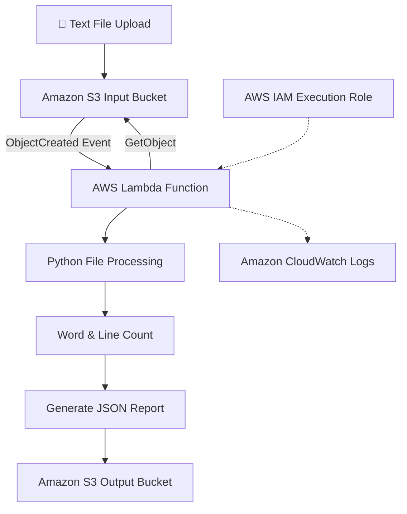

# 🚀 Serverless File Processing System on AWS

<p align="center">
  <strong>An event-driven, serverless file processing application built using AWS S3, AWS Lambda and Python.</strong>
</p>

<p align="center">
  
  
  
  
  
</p>

---

## 📌 Project Overview

The **Serverless File Processing System** is an event-driven application that automatically processes text files uploaded to an Amazon S3 bucket.

Whenever a `.txt` file is uploaded to the input bucket, an S3 event notification automatically invokes an AWS Lambda function. The function reads the uploaded file, analyzes its contents, calculates the number of lines and words, generates a JSON report, and stores the report in a separate S3 output bucket.

The project demonstrates how AWS serverless services can work together to build an automated, scalable and cost-conscious file processing workflow without managing servers.

## 🎯 Project Objectives

- Automate file processing using event-driven architecture.
- Understand how Amazon S3 triggers AWS Lambda.
- Process files using Python and the Boto3 SDK.
- Apply IAM permissions following the principle of least privilege.
- Generate structured JSON reports automatically.
- Monitor Lambda execution through Amazon CloudWatch.

## 🏗️ Architecture



### 🔄 Workflow Explanation

1. **File Upload:** A user uploads a `.txt` file to the input S3 bucket.
2. **Event Notification:** Amazon S3 detects the object creation event and invokes the Lambda function.
3. **File Retrieval:** Lambda uses the Boto3 SDK to retrieve the uploaded file from S3.
4. **File Processing:** Python reads the file and calculates its word count and line count.
5. **Report Generation:** A structured JSON report is generated with the file details and processing results.
6. **Output Storage:** The JSON report is uploaded to a separate S3 output bucket.
7. **Monitoring:** Lambda execution logs are available through Amazon CloudWatch.

## 🛠️ AWS Services & Technologies

| Technology | Purpose |
|---|---|
| Amazon S3 | Stores input text files and generated JSON reports |
| AWS Lambda | Executes file processing automatically |
| Python | Implements file reading and processing logic |
| Boto3 | Enables Python interaction with AWS services |
| AWS IAM | Controls Lambda access to AWS resources |
| Amazon CloudWatch | Stores Lambda execution logs |

## 🔐 Security & IAM Configuration

The Lambda function uses an IAM execution role instead of storing AWS credentials in the application code.

The role is configured with:

- **AWSLambdaBasicExecutionRole:** Allows Lambda to write execution logs to CloudWatch.
- **s3:GetObject:** Allows reading objects from the designated input bucket.
- **s3:PutObject:** Allows writing generated reports to the designated output bucket.

Additional security configurations:

- S3 Block Public Access is enabled.
- S3 default encryption is enabled.
- Separate input and output buckets are used.
- The Lambda function follows least-privilege access principles.

## ⚙️ Implementation Details

**Lambda Function:** `serverless-file-processor`

| Configuration | Value |
|---|---|
| AWS Region | Asia Pacific (Mumbai) — `ap-south-1` |
| Runtime | AWS-managed Python runtime |
| Memory | 128 MB |
| Timeout | 30 seconds |
| Architecture | x86_64 |
| Trigger | S3 ObjectCreated events |
| File filter | `.txt` |

### 📂 Output Report

For every successfully processed input file, the application generates a JSON report containing:

```json
{
    "source_file": "employee_report.txt",
    "input_bucket": "serverless-input-2026",
    "input_key": "employee_report.txt",
    "line_count": 4,
    "word_count": 11,
    "status": "SUCCESS"
}
```

*Example output. Counts depend on the uploaded file.*

Reports are stored under the `processed/` prefix in the output bucket.

## ✅ Current Implementation Status

- [x] Created input and output S3 buckets.
- [x] Configured IAM execution role and permissions.
- [x] Created and deployed the Lambda function.
- [x] Configured S3 event notification for `.txt` files.
- [x] Verified automatic Lambda invocation through CloudWatch logs.
- [x] Implemented file reading and text analysis.
- [x] Generated JSON processing reports.
- [x] Verified report storage in the output S3 bucket.

## 🚧 Future Enhancements

The following improvements are planned:

- [ ] Implement idempotency to handle duplicate S3 notifications safely.
- [ ] Improve failure handling and retry strategies.
- [ ] Configure CloudWatch metrics and alarms.
- [ ] Automate infrastructure provisioning using Terraform.

## 💡 Key Learning Outcomes

Through this project, I am gaining practical experience with:

- Event-driven architecture in AWS.
- Serverless computing using AWS Lambda.
- S3 event notifications and object operations.
- IAM roles, policies and least-privilege access.
- Python-based AWS automation using Boto3.
- CloudWatch logging and troubleshooting.
- Designing cost-conscious cloud solutions.

## 👩‍💻 Author

**Kantamaneni Manusha**

Aspiring Cloud & DevOps Engineer

- GitHub: [@kantamnenimanusha](https://github.com/kantamnenimanusha)
- LinkedIn: [Connect with me](https://www.linkedin.com/in/manusha-kantamaneni-47634b375/)

---

⭐ If you find this project useful, feel free to explore the repository and share your feedback.

**Built while learning AWS, serverless architecture and cloud automation.**
