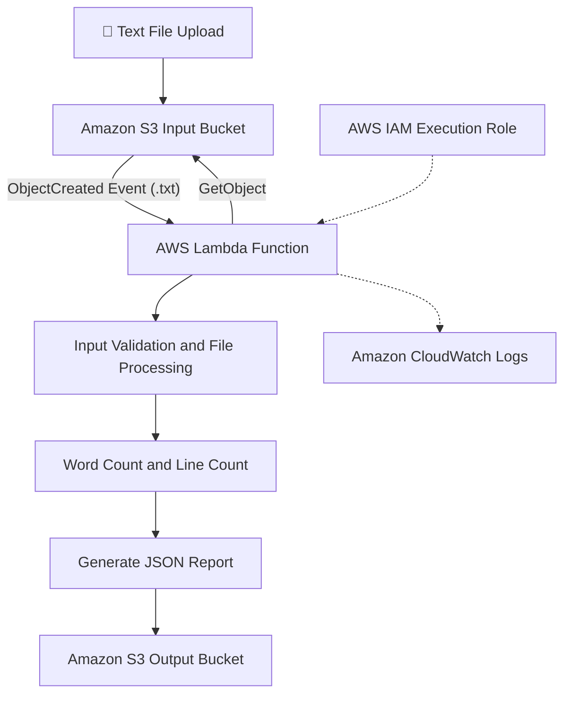
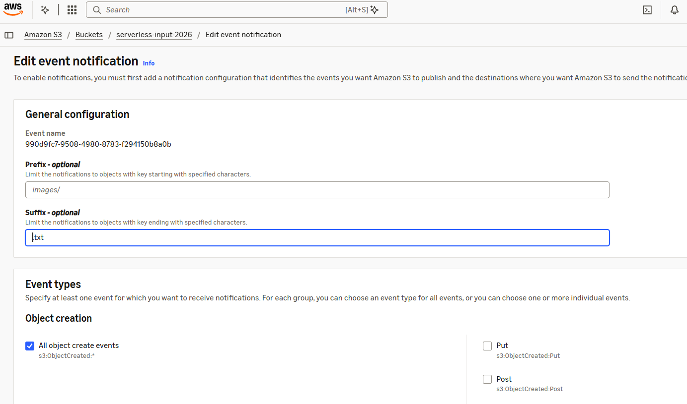
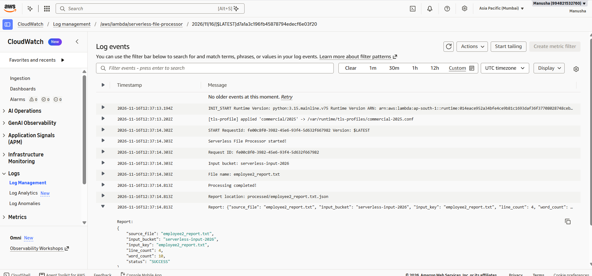
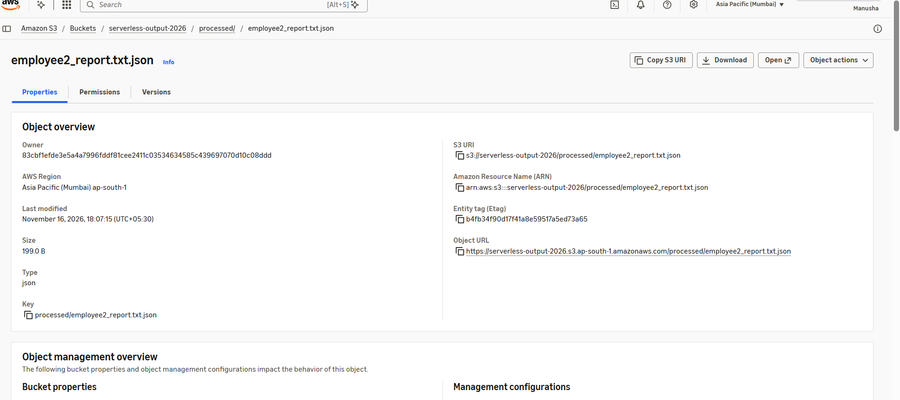

# 🚀 Serverless File Processing System on AWS

<p align="center">
  <strong>An event-driven, serverless file processing application built using Amazon S3, AWS Lambda, Python and Boto3.</strong>
</p>

<p align="center">
  
  
  
  
  
</p>

---

## 📌 Project Overview

The **Serverless File Processing System** is an event-driven application developed on AWS that automatically processes text files uploaded to an Amazon S3 bucket.

Whenever a `.txt` file is uploaded to the input S3 bucket, an S3 event notification automatically invokes an AWS Lambda function.

The Lambda function retrieves the uploaded file, processes its contents using Python, calculates the number of lines and words, generates a structured JSON report and stores the report in a separate S3 output bucket.

The application uses AWS-managed serverless infrastructure, eliminating the need to provision or maintain dedicated servers for the processing workflow.

This project demonstrates practical implementation of AWS serverless services, event-driven architecture, IAM permissions, Python automation, input validation, automated testing and CloudWatch logging.

## 🎯 Project Objectives

- Automate file processing using an event-driven architecture.
- Configure Amazon S3 event notifications to trigger AWS Lambda.
- Process text files using Python and the Boto3 SDK.
- Generate structured JSON reports automatically.
- Implement input validation and exception handling.
- Implement IAM-based access control using an execution role.
- Monitor Lambda executions through Amazon CloudWatch.
- Write automated tests for valid and invalid inputs.

## 🏗️ System Architecture


### Architecture Flow



### 🔄 End-to-End Workflow

1. **File Upload:** A user uploads a `.txt` file to the designated input S3 bucket.
2. **Event Detection:** Amazon S3 detects the object creation event.
3. **Lambda Invocation:** S3 automatically invokes the configured Lambda function.
4. **Input Validation:** Lambda validates the incoming event structure and checks the file extension.
5. **File Retrieval:** Lambda uses Boto3 and its IAM execution role to retrieve the uploaded object.
6. **Content Validation:** The function checks whether the file content can be decoded using UTF-8.
7. **Content Analysis:** Python calculates the word count and line count.
8. **Report Generation:** The function creates a JSON report containing the source file details and processing results.
9. **Output Storage:** The generated JSON report is uploaded to a separate S3 output bucket under the `processed/` prefix.
10. **Monitoring:** Execution details, processing messages and errors are recorded in Amazon CloudWatch Logs.

## 🛠️ AWS Services and Technologies

| Technology | Purpose |
|---|---|
| Amazon S3 | Stores uploaded text files and generated JSON reports |
| AWS Lambda | Executes the processing function automatically |
| Python | Implements file reading, validation and processing logic |
| Boto3 | Enables Python interaction with AWS services |
| AWS IAM | Controls Lambda permissions to access AWS resources |
| Amazon CloudWatch | Collects Lambda execution logs for monitoring and troubleshooting |

## ⚙️ AWS Implementation Details

### 1. Amazon S3 Configuration

Two separate S3 buckets are used:

- **Input bucket:** `serverless-input-2026`
- **Output bucket:** Stores generated JSON reports.

The input bucket is configured with an event notification for:

| Setting | Configuration |
|---|---|
| Event type | All object create events |
| Suffix filter | `.txt` |
| Destination | `serverless-file-processor` Lambda function |

Separating input and output buckets prevents generated reports from triggering the same input-processing workflow.

### 2. AWS Lambda Configuration

**Function name:** `serverless-file-processor`

| Configuration | Value |
|---|---|
| AWS Region | Asia Pacific (Mumbai) — `ap-south-1` |
| Runtime | AWS-managed Python runtime |
| Memory | 128 MB |
| Timeout | 30 seconds |
| Architecture | x86_64 |
| Trigger | Amazon S3 ObjectCreated events |
| File filter | `.txt` |

The Lambda function uses an environment variable named `OUTPUT_BUCKET` to identify the destination S3 bucket.

The Boto3 S3 client is initialized outside the handler to allow reuse across warm Lambda invocations.

### 3. IAM Security Configuration

The Lambda function uses an IAM execution role named `serverless-file-processor-role`.

The role provides the permissions required for the workflow:

| Permission | Purpose |
|---|---|
| `s3:GetObject` | Reads uploaded files from the input bucket |
| `s3:PutObject` | Writes generated reports to the output bucket |
| `AWSLambdaBasicExecutionRole` | Allows Lambda to publish logs to CloudWatch |

Security considerations:

- AWS credentials are not hardcoded in the Python application.
- Lambda accesses AWS services through its execution role.
- S3 Block Public Access is enabled.
- S3 default encryption is enabled.
- Input and output storage are separated.
- Bucket access is restricted through IAM permissions.

## 🐍 Python Implementation

The Lambda function is implemented in `lambda_function.py`.

Its main responsibilities include:

1. Initialize the Boto3 S3 client.
2. Read the destination bucket name from the environment variable.
3. Validate the incoming S3 event structure.
4. Extract the S3 bucket name and object key.
5. Validate the `.txt` file extension.
6. Retrieve the uploaded file using `get_object()`.
7. Decode the content using UTF-8.
8. Calculate the number of lines and words.
9. Generate a JSON report.
10. Upload the report using `put_object()`.

### Input Validation and Error Handling

The implementation includes:

- Validation of the incoming event and S3 record structure.
- Checks for missing bucket details and object keys.
- File extension validation to accept `.txt` files only.
- UTF-8 decoding validation.
- Clear error messages for unsupported file types and invalid file encodings.
- Structured logging through Python's `logging` module.
- Exception logging with traceback information.
- Re-raising exceptions so failed processing is reported to Lambda.

The S3 object key is decoded using `unquote_plus()` to handle URL-encoded object keys.

### CloudWatch Logging

The application records:

- Lambda invocation start.
- AWS Lambda request ID.
- Input bucket and file name.
- Successful processing messages.
- Generated report location.
- Processing errors and traceback details.

The complete implementation is available in [`lambda_function.py`](lambda_function.py).

## 📄 Sample Input and Output

### Sample Input

File: `employee_report_sample.txt`

```text
Name: Alex Morgan
Department: Engineering
Experience: 2 years
Skills: Python, AWS, Linux
```

### Generated JSON Report

Example output:

```json
{
    "source_file": "employee_report_sample.txt",
    "input_bucket": "serverless-input-2026",
    "input_key": "sample-data/employee_report_sample.txt",
    "line_count": 4,
    "word_count": 12,
    "status": "SUCCESS"
}
```

The example demonstrates the report structure. Actual bucket keys and processing counts depend on the uploaded file.

Generated reports are stored in the output bucket under the `processed/` prefix.

## 📸 Project Screenshots

The following screenshots document the AWS implementation and execution workflow.

### 1. Lambda Function Overview

Shows the deployed Lambda function and its configured S3 trigger.


### 2. S3 Event Notification

Shows the input bucket's object-created event notification configuration and `.txt` suffix filter.



### 3. CloudWatch Execution Logs

Shows the Lambda invocation and processing messages recorded in CloudWatch.



### 4. Generated JSON Report

Shows the JSON report stored in the S3 output bucket after processing.



## 🧪 Testing and Verification

The project was tested through local automated tests and actual AWS integration.

### Automated Tests

The test suite is implemented in `test_validation.py`.

Run the tests locally using:

```bash
python -m unittest test_validation -v
```

The local tests use mocked AWS interactions, so they do not require actual S3 uploads or Lambda invocations.

| Test Case | Expected Behaviour | Result |
|---|---|---|
| Empty event | Return without processing | Passed |
| Missing S3 object details | Raise a validation error | Passed |
| Unsupported file type (`.pdf`) | Reject the file | Passed |
| Invalid UTF-8 content | Raise a clear encoding error | Passed |
| Valid text file | Generate the correct JSON report | Passed |

**Automated test result: 5/5 tests passed.**

### AWS Integration Testing

The deployed application was also tested using actual S3 uploads.

Verified workflow:

- [x] Uploading a `.txt` file to the input bucket.
- [x] Automatic Lambda invocation through an S3 event notification.
- [x] Retrieving the uploaded file using Boto3.
- [x] Calculating word and line counts.
- [x] Generating a structured JSON report.
- [x] Storing the generated report in the output bucket.
- [x] Verifying successful Lambda execution through CloudWatch Logs.
- [x] Confirming the generated JSON report in S3.
- [x] Testing exception handling using a malformed manual Lambda test event.

**Verified AWS processing examples:**

| Test file | Lines | Words | Status |
|---|---:|---:|---|
| `employee_report_sample.txt` | 4 | 12 | SUCCESS |
| `employee_report_error_handling_test.txt` | 3 | 10 | SUCCESS |

The malformed manual Lambda test also confirmed that exceptions are logged with traceback information and failed invocations are reported correctly.

## 📂 Repository Structure

```text
serverless-file-processor/
│
├── lambda_function.py
├── test_validation.py
├── README.md
├── .gitignore
│
├── sample-data/
│   └── employee_report_sample.txt
│
├── sample-output/
│   └── employee_report_sample.json
│
└── docs/
    └── images/
        ├── architecture.png
        ├── lambda-overview.png
        ├── s3-event-notification.png
        ├── cloudwatch-execution.png
        └── generated-json-report.png
```

## 🚀 Future Enhancements

The following improvements can extend the current implementation:

- [ ] Handle empty files explicitly.
- [ ] Implement idempotency to safely handle duplicate S3 notifications.
- [ ] Improve failure handling with configurable retry strategies.
- [ ] Configure CloudWatch metrics and alarms.
- [ ] Provision AWS infrastructure using Terraform.
- [ ] Introduce CI/CD automation for deployment.
- [ ] Explore dead-letter queues for failed asynchronous processing.

## 🎓 Key Learning Outcomes

Through this project, I gained practical experience with:

- AWS serverless computing using Lambda.
- Event-driven architecture using S3 notifications.
- S3 object operations using Python and Boto3.
- IAM execution roles and access permissions.
- Input validation and exception handling.
- Automated testing using Python `unittest` and mocking.
- CloudWatch logging and troubleshooting.
- Building and documenting an end-to-end cloud project.

## 👩‍💻 Author

**Kantamaneni Manusha**

Aspiring Cloud & DevOps Engineer

- GitHub: [@kantamnenimanusha](https://github.com/kantamnenimanusha)
- LinkedIn: [Connect with me](https://www.linkedin.com/in/manusha-kantamneni-47634b375/)

---

⭐ If you find this project useful, feel free to explore the repository and share your feedback.

**Built while learning AWS, serverless architecture and cloud automation.**