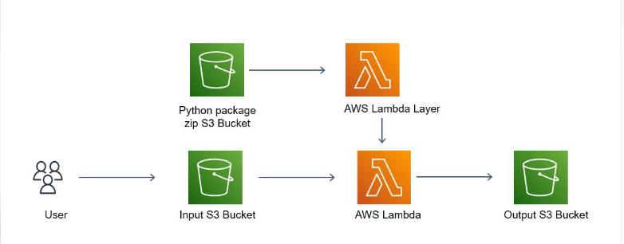
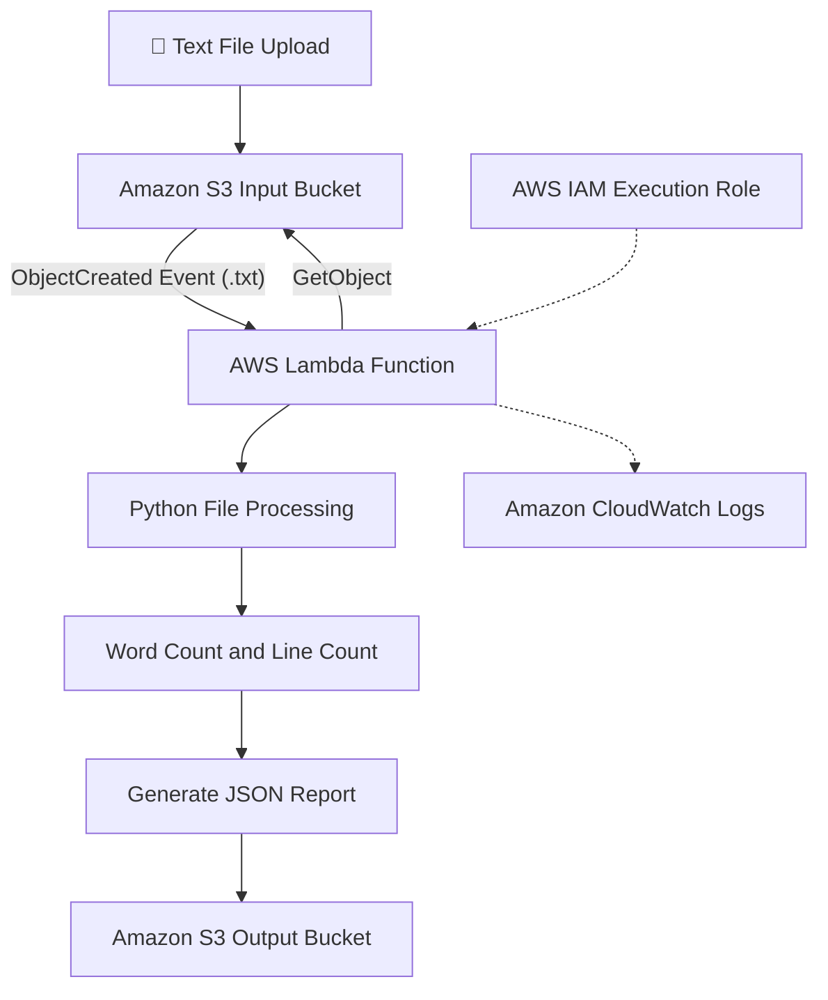
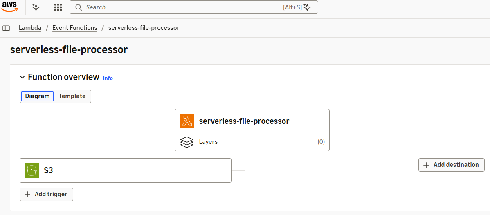

# 🚀 Serverless File Processing System on AWS

<p align="center">
  <strong>An event-driven, serverless file processing application built using Amazon S3, AWS Lambda, Python and Boto3.</strong>
</p>

<p align="center">
  
  
  
  
  
</p>

---

## 📌 Project Overview

The **Serverless File Processing System** is an event-driven application developed on AWS that automatically processes text files uploaded to an Amazon S3 bucket.

Whenever a `.txt` file is uploaded to the input S3 bucket, an S3 event notification automatically invokes an AWS Lambda function.

The Lambda function retrieves the uploaded file, processes its contents using Python, calculates the number of lines and words, generates a structured JSON report and stores the report in a separate S3 output bucket.

The application uses AWS-managed serverless infrastructure, eliminating the need to provision or maintain dedicated servers for the processing workflow.

This project demonstrates practical implementation of AWS serverless services, event-driven architecture, IAM permissions, Python automation and CloudWatch logging.

## 🎯 Project Objectives

- Automate file processing using an event-driven architecture.
- Configure Amazon S3 event notifications to trigger AWS Lambda.
- Process text files using Python and the Boto3 SDK.
- Generate structured JSON reports automatically.
- Implement IAM-based access control using an execution role.
- Monitor Lambda executions through Amazon CloudWatch.
- Understand how AWS serverless services integrate in a real-world workflow.

## 🏗️ System Architecture



### Architecture Flow



### 🔄 End-to-End Workflow

1. **File Upload:** A user uploads a `.txt` file to the designated input S3 bucket.
2. **Event Detection:** Amazon S3 detects the object creation event.
3. **Lambda Invocation:** S3 automatically invokes the configured Lambda function.
4. **File Retrieval:** Lambda uses Boto3 and its IAM execution role to retrieve the uploaded object.
5. **Content Analysis:** Python reads the file and calculates its word count and line count.
6. **Report Generation:** The function creates a JSON report containing the source file details and processing results.
7. **Output Storage:** The generated JSON report is uploaded to a separate S3 output bucket under the `processed/` prefix.
8. **Monitoring:** Execution details and processing messages are recorded in Amazon CloudWatch Logs.

## 🛠️ AWS Services and Technologies

| Technology | Purpose |
|---|---|
| Amazon S3 | Stores uploaded text files and generated JSON reports |
| AWS Lambda | Executes the processing function automatically |
| Python | Implements file reading and processing logic |
| Boto3 | Enables Python interaction with AWS services |
| AWS IAM | Controls Lambda permissions to access AWS resources |
| Amazon CloudWatch | Collects Lambda execution logs for monitoring and troubleshooting |

## ⚙️ AWS Implementation Details

### 1. Amazon S3 Configuration

Two separate S3 buckets are used:

- **Input bucket:** `serverless-input-2026`
- **Output bucket:** Stores generated JSON reports.

The input bucket is configured with an event notification for:

| Setting | Configuration |
|---|---|
| Event type | All object create events |
| Suffix filter | `.txt` |
| Destination | `serverless-file-processor` Lambda function |

Separating input and output buckets prevents generated reports from triggering the same input-processing workflow.

### 2. AWS Lambda Configuration

**Function name:** `serverless-file-processor`

| Configuration | Value |
|---|---|
| AWS Region | Asia Pacific (Mumbai) — `ap-south-1` |
| Runtime | AWS-managed Python runtime |
| Memory | 128 MB |
| Timeout | 30 seconds |
| Architecture | x86_64 |
| Trigger | Amazon S3 ObjectCreated events |
| File filter | `.txt` |

The Lambda function uses an environment variable named `OUTPUT_BUCKET` to identify the destination S3 bucket.

The Boto3 S3 client is initialized outside the handler to allow reuse across warm Lambda invocations.

### 3. IAM Security Configuration

The Lambda function uses an IAM execution role named `serverless-file-processor-role`.

The role provides the permissions required for the workflow:

| Permission | Purpose |
|---|---|
| `s3:GetObject` | Reads uploaded files from the input bucket |
| `s3:PutObject` | Writes generated reports to the output bucket |
| `AWSLambdaBasicExecutionRole` | Allows Lambda to publish logs to CloudWatch |

Security considerations:

- AWS credentials are not hardcoded in the Python application.
- Lambda accesses AWS services through its execution role.
- S3 Block Public Access is enabled.
- S3 default encryption is enabled.
- Input and output storage are separated.
- Bucket access is restricted through IAM permissions.

## 🐍 Python Implementation

The Lambda function is implemented in `lambda_function.py`.

Its main operations are:

1. Initialize the Boto3 S3 client.
2. Read the destination bucket name from the environment variable.
3. Extract the S3 bucket name and object key from the incoming event.
4. Retrieve the uploaded text file using `get_object()`.
5. Calculate the number of lines and words.
6. Generate a JSON report.
7. Upload the report using `put_object()`.

### Core Processing Logic

```python
response = s3.get_object(
    Bucket=input_bucket,
    Key=file_key
)

file_content = response["Body"].read().decode("utf-8")

line_count = len(file_content.splitlines())
word_count = len(file_content.split())

report = {
    "source_file": PurePosixPath(file_key).name,
    "input_bucket": input_bucket,
    "input_key": file_key,
    "line_count": line_count,
    "word_count": word_count,
    "status": "SUCCESS"
}

output_key = f"processed/{file_key}.json"

s3.put_object(
    Bucket=OUTPUT_BUCKET,
    Key=output_key,
    Body=json.dumps(report, indent=4).encode("utf-8"),
    ContentType="application/json"
)
```

The complete implementation is available in [`lambda_function.py`](lambda_function.py).

## 📂 Sample Input and Output

### Sample Input

File: `employee_report_sample.txt`

```text
Name: Alex Morgan
Department: Engineering
Experience: 2 years
Skills: Python, AWS, Linux
```

### Generated JSON Report

Example output:

```json
{
    "source_file": "employee_report_sample.txt",
    "input_bucket": "serverless-input-2026",
    "input_key": "sample-data/employee_report_sample.txt",
    "line_count": 4,
    "word_count": 12,
    "status": "SUCCESS"
}
```

The example demonstrates the report structure. Actual bucket keys and processing counts depend on the uploaded file.

Generated reports are stored in the output bucket under the `processed/` prefix.

## 📸 Project Screenshots

The following screenshots document the AWS implementation and execution workflow.

### 1. Lambda Function Overview

Shows the deployed Lambda function and its configured S3 trigger.



### 2. S3 Event Notification

Shows the input bucket's object-created event notification configuration and `.txt` suffix filter.


### 3. CloudWatch Execution Logs

Shows the Lambda invocation and processing messages recorded in CloudWatch.


### 4. Generated JSON Report

Shows the JSON report stored in the S3 output bucket after processing.


## 🧪 Testing and Verification

The initial end-to-end workflow was tested using text files uploaded to the input S3 bucket.

The following operations were verified:

- [x] Uploading a `.txt` file to the input bucket.
- [x] Automatic Lambda invocation through an S3 event notification.
- [x] Retrieving the uploaded file using Boto3.
- [x] Calculating word and line counts.
- [x] Generating a structured JSON report.
- [x] Storing the generated report in the output bucket.
- [x] Verifying successful Lambda execution through CloudWatch Logs.
- [x] Confirming the generated JSON report in S3.

## 📁 Repository Structure

```text
serverless-file-processor/
│
├── lambda_function.py
├── README.md
├── .gitignore
│
├── sample-data/
│   └── employee_report_sample.txt
│
├── sample-output/
│   └── employee_report_sample.json
│
└── docs/
    └── images/
        ├── architecture.png
        ├── lambda-overview.png
        ├── s3-event-notification.png
        ├── cloudwatch-execution.png
        └── generated-json-report.png
```

## 🚧 Future Enhancements

The current implementation demonstrates the basic end-to-end workflow. The following improvements are planned:

- [ ] Add robust exception handling and meaningful error messages.
- [ ] Validate file types and handle invalid file encodings.
- [ ] Handle empty files explicitly.
- [ ] Implement idempotency to safely handle duplicate S3 notifications.
- [ ] Improve failure handling and retry strategies.
- [ ] Configure CloudWatch metrics and alarms.
- [ ] Add automated unit tests for the processing logic.
- [ ] Provision AWS infrastructure using Terraform.
- [ ] Improve deployment automation through a CI/CD pipeline.

## 💡 Key Learning Outcomes

Through this project, I gained practical experience with:

- AWS serverless computing using Lambda.
- Event-driven architecture using S3 notifications.
- S3 object operations using Python and Boto3.
- IAM execution roles and least-privilege permissions.
- CloudWatch logging and troubleshooting.
- AWS resource configuration and integration.
- Building and documenting an end-to-end cloud project.

## 👩‍💻 Author

**Kantamaneni Manusha**

Aspiring Cloud & DevOps Engineer

- GitHub: [@kantamnenimanusha](https://github.com/kantamnenimanusha)
- LinkedIn: [Connect with me](https://www.linkedin.com/in/manusha-kantamneni-47634b375/)

---

⭐ If you find this project useful, feel free to explore the repository and share your feedback.

**Built while learning AWS, serverless architecture and cloud automation.**
